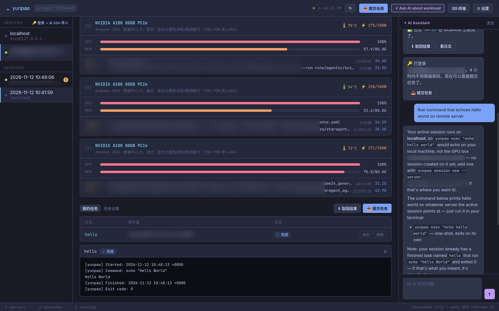

<a id="readme-top"></a>

<!-- PROJECT SHIELDS -->
<!-- https://www.markdownguide.org/basic-syntax/#reference-style-links -->
[![Contributors][contributors-shield]][contributors-url]
[![Forks][forks-shield]][forks-url]
[![Stargazers][stars-shield]][stars-url]
[![Issues][issues-shield]][issues-url]
[![License][license-shield]][license-url]

<!-- PROJECT LOGO -->
<br />
<div align="center">
  <a href="https://github.com/alex-karev/yunpao">
    
  </a>

  <h3 align="center">YunPao</h3>

  <p align="center">
    Session and task manager for remote builds, remote execution and machine learning
    <!-- <br /> -->
    <!-- <a href="https://github.com/alex-karev/yunpao"><strong>Explore the docs »</strong></a> -->
    <!-- <br /> -->
    <br />
    &middot;
    <a href="https://github.com/alex-karev/yunpao/issues/new?labels=bug&template=bug-report---.md">Report Bug</a>
    &middot;
    <a href="https://github.com/alex-karev/yunpao/issues/new?labels=enhancement&template=feature-request---.md">Request Feature</a>
  </p>
</div>

<!-- TABLE OF CONTENTS -->
<details>
  <summary>Table of Contents</summary>
  <ol>
    <li>
      <a href="#about-the-project">About The Project</a>
    </li>
    <li>
      <a href="#getting-started">Getting Started</a>
      <ul>
        <li><a href="#prerequisites">Prerequisites</a></li>
        <li><a href="#installation">Installation</a></li>
      </ul>
    </li>
    <li>
    <a href="#usage">Usage</a>
      <ul>
        <li><a href="#quick-start">Quick start</a></li>
        <li><a href="#web-dashboard">Web dashboard</a></li>
        <li><a href="#research-skills">Research skills</a></li>
        <li><a href="#how-it-works">How it works</a></li>
      </ul>
    </li>
    <li><a href="#roadmap">Roadmap</a></li>
    <li><a href="#contributing">Contributing</a></li>
    <li><a href="#ai-disclosure">AI Disclosure</a></li>
    <li><a href="#license">License</a></li>
    <li><a href="#contact">Contact</a></li>
    <li><a href="#acknowledgments">Acknowledgments</a></li>
  </ol>
</details>

<!-- ABOUT THE PROJECT -->
## About The Project

<div align="center">
  <a href="https://github.com/alex-karev/yunpao/blob/main/assets/demo.gif?raw=true">
      
  </a>
</div>

A CLI tool that helps syncing project files with remote server, run actions and commands in the background and download resulting artifacts. The main purpose is to offload heavy operations to a more powerful device. It can be used for running remote builds, machine learning and processing large amounts of data. Everything is done over SSH and the only requirement for a remote server is to have `rsync` installed.

**Features**:

* Lightweight and written in Rust.
* Fire-and-forget: all actions are running in the background, no need keeping SSH connection open or keeping your machine on.
* Watch logs in real-time, disconnect and reconnect any time you want.
* Fine-grained control over which artifacts are downloaded in the end.
* Supports multiple sessions with multiple servers at the same time.
* Advanced environment configuration with per-project variables via dotenv file, per-server variables and system-wide variables.
* Server and session manager included.
* Web dashboard for remote jobs, logs, NVIDIA GPU monitoring and SSH terminals.
* Works with any Linux server. No server-side configuration needed aside from installing `rsync`.
* Does not clutter your system (both local and remote). Operates entirely in `~/.cache/yunpao` and can be removed any time.
* Simple and well-documented configuration format.
* Can be used in non-interactive manner with your AI agent of choice.

> The name comes from Chinese "云跑", where "云" means "cloud" and "跑" means "run".

<p align="right">(<a href="#readme-top">back to top</a>)</p>

<!-- GETTING STARTED -->
## Getting Started

### Prerequisites

1. Install [rust compiler](https://rust-lang.org/tools/install/).
2. Install openssh client and rsync:

```sh
# For Ubuntu/Debian:
sudo apt install openssh-client rsync

# For CentOS/RHEL/Fedora:
sudo yum install openssh-clients rsync

# For Alpine:
sudo apk add openssh-client rsync
```

### Installation

Cargo:

```sh
git clone https://github.com/alex-karev/yunpao.git
cd yunpao
cargo install --path .
```

Arch:

```sh
curl -O https://raw.githubusercontent.com/alex-karev/yunpao/main/PKGBUILD
makepkg -si
```

Debian/Ubuntu:

```sh
cargo install cargo-deb
git clone https://github.com/alex-karev/yunpao.git
cd yunpao
cargo-deb
sudo dpkg -i target/debian/yunpao_*.deb  
```

*Pre-build releases will come later in the future*

<p align="right">(<a href="#readme-top">back to top</a>)</p>

<!-- USAGE EXAMPLES -->
## Usage

### Quick Start

```sh
cd myproject
yunpao init
yunpao server new
yunpao session new
yunpao run --watch myaction
yunpao pull
```

1. Open your project in terminal.
2. Run `yunpao init` to create `yunpao.toml`. Set actions and artifacts to be downloaded (*read comments in it for more details*).
3. Add new server via `yunpao server add`.
4. Start new session via `yunpao session new`. Choose the server you've added.
5. Run action on remote server with `yunpao run [actionname]`.
6. See logs with `yunpao logs [actionname]` or watch it real-time using `yunpao watch [actionname]`.
7. Download artifacts using `yunpao pull`.

> Run `yunpao --help` for more examples. You can also run each sub-command with `--help` flag to get more details.

> WARNING: `yunpao push|run` uploads everything except for `.git` directory or patterns listed in `.gitignore`, while `yunpao pull` only downloads files specified in "artifacts" section in `yunpao.toml`

### Web dashboard

From a project directory containing `yunpao.toml`, launch the dashboard:

```sh
yunpao ui
```

The dashboard opens in your browser at `http://localhost:8080`. It listens on localhost only. Use `yunpao ui --port 8081` to choose another port, or `yunpao ui --no-open` to open the URL manually. Stop the dashboard with Ctrl+C.

Use the dashboard to view servers and sessions, import SSH hosts, monitor NVIDIA GPU usage, submit and stop jobs, inspect logs and job history, pull results, and open an SSH terminal. It also includes a job queue and an optional AI assistant.

<div align="center">
  
</div>

### Research skills

Three optional agent skills organize research into paper collection, idea development, and experiments. Each skill defines its inputs, procedure, artifacts, and completion criteria. The skill instructions are currently written in Chinese.

| Stage | Skill | Outputs in the research directory |
| --- | --- | --- |
| Collect papers | [research-collect-papers](skills/research-collect-papers/SKILL.md) | `papers/papers.json` and `papers/survey.md`: source-linked papers, method comparisons, and research gaps |
| Develop ideas | [research-generate-ideas](skills/research-generate-ideas/SKILL.md) | `ideas/ideas.md` and `ideas/idea.json`: candidate comparisons, a testable hypothesis, and a minimal experiment plan |
| Run experiments | [research-run-experiments](skills/research-run-experiments/SKILL.md) | `experiments/<run-id>/`: the frozen plan, metrics, logs, and an evidence-backed report |

Ask your AI agent to read the linked `SKILL.md` for the stage you need, or install that skill directory using your agent's skill-loading mechanism. Pass the preceding stage's output files as inputs. An experiment report can feed the next idea revision, and missing literature evidence can lead back to paper collection.

The experiment skill uses YunPao's existing server/session configuration and `run`, `logs` / `watch`, and `pull` commands for remote execution. Configure the experiment action and artifact paths in `yunpao.toml` first. Completion requires the planned results and their supporting evidence, including unsuccessful hypotheses; starting a background task alone is not completion. These files provide workflows for external AI agents and do not add CLI commands or automatically load into `yunpao ask` or the dashboard assistant.

The general [YunPao agent skill](SKILL.md) documents the CLI and links to these workflows.

### How it works

YunPao operates on Projects, Servers, Sessions and Actions:

* **Project** - your project described in `yunpao.toml`. Similar to `package.json` in NodeJS, project configuration determines commands to run when using `yunpao run`, artifacts to download when using `yunpao pull` etc.
* **Server** - remote server configuration stored globally in `~/.config/yunpao/config.toml`. Defines user, host, port and identity file to use for each remote server. Every server can be used across multiple projects and multiple sessions within one project.
* **Session** - specific environment, a link between project and server. Each project can have multiple sessions and they can be switched using `yunpao session switch`. When using `yunpao push` or `yunpao run`, project files are uploaded to `~/.cache/yunpao/sessions/[session_id]/working` directory on remote server, which resolves conflicts when dealing with multiple sessions using one server.
- **Action** - command specified in `yunpao.toml`. Executed on remote server using `yunpao run`. Only one instance of each action can be running during the same session. If you need to run 2 instances of the same action at the same time - switch sessions.

Servers and sessions can be managed using relevant sub-commands:

```
yunpao server list|new|delete|clear|ssh|copy-id
yunpao session list|new|delete|switch
```

See `yunpao server help` and `yunpao session help` for more details.

<p align="right">(<a href="#readme-top">back to top</a>)</p>

<!-- ROADMAP -->
## Roadmap

- [x] Check for typos
- [x] Add Arch PKGBUILD
- [x] Write proper README
- [x] Open repo
- [x] Publish to crates.io
- [x] Add argument handling to `yunpao run`
- [x] Add demo screenshots
- [x] Add background running for `yunpao exec`
- [x] Fix error exit code after ctrl+c from watch
- [x] Add skill for agents
- [ ] Refactor `ssh.rs`

See the [open issues](https://github.com/alex-karev/yunpao/issues) for a full list of proposed features (and known issues).

<p align="right">(<a href="#readme-top">back to top</a>)</p>


<!-- CONTRIBUTING -->
## Contributing

Contributions are what make the open source community such an amazing place to learn, inspire, and create. Any contributions you make are **greatly appreciated**.

If you have a suggestion that would make this better, please fork the repo and create a pull request. You can also simply open an issue with the tag "enhancement".
Don't forget to give the project a star! Thanks again!

1. Fork the Project
2. Create your Feature Branch (`git checkout -b feature/AmazingFeature`)
3. Commit your Changes (`git commit -m 'Add some AmazingFeature'`)
4. Push to the Branch (`git push origin feature/AmazingFeature`)
5. Open a Pull Request

Vibe-coded, low quality AI contributions are **discouraged**.

### Top contributors:

<a href="https://github.com/alex-karev/yunpao/graphs/contributors">
  
</a>

<p align="right">(<a href="#readme-top">back to top</a>)</p>

<!-- AI DISCLOSURE -->
## AI Disclosure

Earliest versions (before the UI update) were developed without any AI tools. AI was only used for getting unstuck while fighting the borrow-checker. Originally, this was a passion project made to practice writing Rust code and all AI contributions were discouraged.

However, considering the limited time and resources of the core contributors, we now accept contributions made with AI with the condition that they are of a **high quality** and **reviewed manually**. Low-quality, low-effort contributions are still **discouraged**, whether they were made with the help of AI or not.

AI was **NOT** used for the logo (source `.svg` file is available).
<!-- LICENSE -->
## License

Distributed under the GPL-3.0 License. See `LICENSE` for more information.

<p align="right">(<a href="#readme-top">back to top</a>)</p>


<!-- CONTACT -->
## Contact

Project Link: [https://github.com/alex-karev/yunpao](https://github.com/alex-karev/yunpao)

<p align="right">(<a href="#readme-top">back to top</a>)</p>

<!-- ACKNOWLEDGMENTS -->
## Acknowledgments

* [Mainframer](https://github.com/buildfoundation/mainframer) - Inspiration for this project, awesome tool for remote builds, but lacks background task execution, server and session management. Much simpler version of what this project is aimed for.
* [Best-README-Template](https://github.com/othneildrew/Best-README-Template) - for readme template

<p align="right">(<a href="#readme-top">back to top</a>)</p>

<!-- MARKDOWN LINKS & IMAGES -->
<!-- https://www.markdownguide.org/basic-syntax/#reference-style-links -->
---

## Why yunpao instead of tmux?

tmux is a terminal multiplexer — it keeps a shell session alive on a remote machine. It was designed for interactive work, not for running automated workflows. yunpao is purpose-built for the same underlying need (long-running remote tasks) but solves it differently.

### tmux's shortcomings for ML / build workflows

| Problem | tmux | yunpao |
|---------|------|--------|
| **File sync** | You must `rsync` or `scp` manually every time you change code | `yunpao push` / `yunpao pull` are built in and tracked per session |
| **Session coupling** | Detaching from tmux still requires you to know which window/pane holds your process | Sessions are named and project-scoped; switch with one command |
| **Log persistence** | Logs live inside the tmux pane — close the terminal and scroll back is gone | yunpao streams logs to a file; `yunpao logs <action>` retrieves them any time |
| **Multi-server** | You open one SSH connection per server manually | yunpao registers servers by alias; `--server gpu-box` routes automatically |
| **Automation / scripting** | tmux `send-keys` is brittle and hard to script reliably | Every yunpao command is a first-class CLI call; scriptable from CI or cron |
| **Visibility** | No overview of what is running where across servers | `yunpao tui` shows all sessions and running tasks in a single panel; `yunpao ui` opens a web dashboard |
| **Natural language** | None | `yunpao ask "run the training job on the GPU server"` translates to the right command automatically |
| **Editor integration** | None | A VS Code extension exposes sessions, actions, and logs in the sidebar |

### In short

tmux answers: *"How do I keep this shell alive?"*  
yunpao answers: *"How do I manage my remote project, its data, its tasks, and its servers — from any machine, any editor?"*

yunpao is not a replacement for tmux at the shell level; it uses SSH under the hood just like tmux does. The difference is the layer it operates at: **workflow management** instead of terminal emulation.

---

[contributors-shield]: https://img.shields.io/github/contributors/alex-karev/yunpao.svg?style=for-the-badge
[contributors-url]: https://github.com/alex-karev/yunpao/graphs/contributors
[forks-shield]: https://img.shields.io/github/forks/alex-karev/yunpao.svg?style=for-the-badge
[forks-url]: https://github.com/alex-karev/yunpao/network/members
[stars-shield]: https://img.shields.io/github/stars/alex-karev/yunpao.svg?style=for-the-badge
[stars-url]: https://github.com/alex-karev/yunpao/stargazers
[issues-shield]: https://img.shields.io/github/issues/alex-karev/yunpao.svg?style=for-the-badge
[issues-url]: https://github.com/alex-karev/yunpao/issues
[license-shield]: https://img.shields.io/github/license/alex-karev/yunpao.svg?style=for-the-badge
[license-url]: https://github.com/alex-karev/yunpao/blob/master/LICENSE
